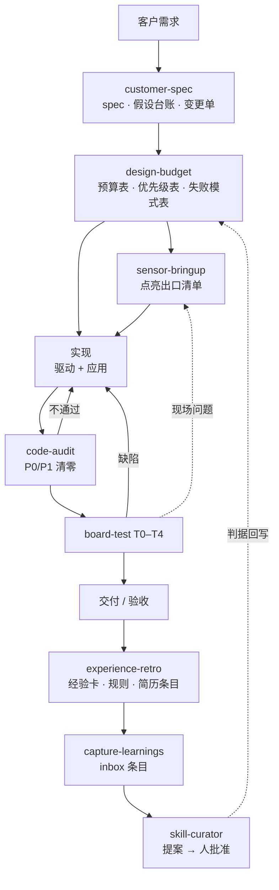

# 工作流闭环（workflow）

技能之间靠**工件**连接，不靠记忆。本文件定义：每个阶段产出什么、谁消费、门禁是什么、不达标退回哪一段。

## 全流程

## 门禁表

每段的出口是下一段的入口。**不达标就退回，不靠"先往下走再说"。**

| 阶段 | 技能 | 入口条件 | 出口工件 | 门禁判据 | 不达标退回 |
|---|---|---|---|---|---|
| 接需求 | `customer-spec` | 客户有诉求 | spec 十段 + 假设台账 | 每条验收标准可被第三人判定；客户已确认 | 重新访谈 |
| 方案 | `design-budget` | spec 已签字 | 预算表 / 优先级表 / 失败模式表 / 接口 / 状态机 | 六表齐全且互相一致；预算有余量 | 重算或多轮取舍 |
| 点亮 | `sensor-bringup` | 板子可用 | 点亮出口清单 + 证据日志 | 7 项出口全过（ID/快照/数据随激励/异常恢复/集成/归档/回写） | 留在本层，不许进实现 |
| 审计 | `code-audit` | 代码可编译 + 三张表 | 审计报告 | 告警清零；P0/P1 全部有结论；三张表已验证 | 退回实现 |
| 测试 | `board-test` | 审计通过 | 测试计划 + 报告 | T0/T1 全绿；T2 自动出报告；T3 对齐 spec 第 1 段 | 退回实现或点亮 |
| 交付 | `board-test` T3 + spec 第 10 段 | 回归通过 | 交付包 + 验收记录 | 客户用例逐条通过并签字 | 退回测试 |
| 复盘 | `experience-retro` | 项目收尾或卡点解决 | 经验卡 + 规则 + 简历条目 | 至少一条可执行规则；已回写技能 | 当场重填 |
| 沉淀 | `capture-learnings` | 会话收尾 | inbox 条目 | 有对话内证据；≤5 条；不重复 | 不记 |
| 维护 | `skill-curator` | inbox 攒够 5 条 | 带 diff 的提案 | 两次复现或单次重大损失；eval 不降 | 继续观察 |

## 交接契约

这是"闭环"的实际内容——**上游的输出必须是下游能直接用的形式**。

| 工件 | 产出者 | 消费者 | 用在什么环节 |
|---|---|---|---|
| 验收定义（spec 第 1 段） | `customer-spec` | `board-test` T3 | 用例来源 |
| 异常策略（spec 第 8 段） | `customer-spec` | `design-budget` D5 | 失败模式表必须逐条覆盖 |
| 预算表 | `design-budget` D1 | `code-audit` A0/A1、`board-test` | 堆/栈/资源判据 |
| 优先级表 | `design-budget` D2 | `code-audit` A2 | 唯一性、RM 顺序校验 |
| 模块接口（`bus_ops`） | `design-budget` D3 | `board-test` T1 | 打桩点 |
| 错误码表 | `design-budget` D4 | `customer-spec` 第 8 段、`board-test` T3 | 判定依据 |
| 点亮出口清单 | `sensor-bringup` | `code-audit` A4/A5、`board-test` | 硬件可信前提 |
| 审计报告 P0/P1 | `code-audit` | 交付评审 | 合入门禁 |
| 经验卡的"可复用规则" | `experience-retro` | `skill-curator` | 判据来源 |
| inbox 条目 | `capture-learnings` | `skill-curator` T1 | 提案原料 |

## 覆盖度（诚实版）

| 阶段 | 覆盖 | 说明 |
|---|---|---|
| 接需求 | ✅ 完整 | |
| 方案与预算 | ✅ 完整 | 新增，补上原本的断点 |
| 器件点亮 | ✅ 完整 | |
| 驱动实现 | 🟡 偏薄 | 有 `bus_ops` 约定和审计兜底，没有逐步实现规范 |
| 应用实现 | 🟡 偏薄 | 编码纪律由 `code-audit` 事后抓，事中只靠个人习惯 |
| 代码审计 | ✅ 完整 | |
| 测试 | ✅ 完整 | T0–T4 覆盖单元到长稳 |
| 交付与验收 | 🟡 偏薄 | 有 T3 和 spec 第 10 段，但没有交付包清单/版本冻结流程 |
| **发布 / 产线** | ❌ **缺** | 版本号规则、出厂自检、产线测试、OTA、回滚 |
| **现场支持** | ❌ **缺** | 故障复现、日志回传、批量问题归因 |
| 复盘 | ✅ 完整 | |
| 沉淀与维护 | ✅ 完整 | |

两个缺口的建议形态（还没写，等你的场景对齐）：

- **`release`**：版本号与变更记录、出厂自检脚本、产线测试夹具与判据、OTA 包结构与回滚、发布前 checklist。
- **`field-support`**：现场问题的最小复现信息清单（固件版本/复位原因/错误计数/最近日志）、日志回传格式、批量归因方法、现场升级流程。

## "闭环"的三层含义

判断一套流程是不是闭环，看这三条，缺一条就只是流水线：

1. **工件闭环**：每个技能的输出都是下一个技能的输入，没有"写完就扔"的文档。（看上面的交接契约表）
2. **门禁闭环**：不达标不能进下一阶段，且知道退回哪一段。（看门禁表）
3. **反馈闭环**：缺陷能回流到**正确的**阶段，沉淀能改写判据。
   - 点亮出的问题回到 `sensor-bringup` 对应层，不要回应用层重写
   - 审计的 P0 回到实现，不要靠测试兜
   - 现场问题先回到点亮/审计，不要直接改代码
   - 经验通过 `capture-learnings` → `skill-curator` 回写到判据，**下一轮自动更准**

第三条是这套东西和普通 checklist 的分水岭：checklist 只增不减，这套会因为反馈而变准、也会因为退役而变短。

## 怎么用

不用记九段。只需要回答一个问题：**你现在卡在哪一段？**

| 你的感觉 | 进哪一段 |
|---|---|
| 客户说不清要什么 / 需求老变 | `customer-spec` |
| 不知道 RAM 够不够 / 任务怎么分 | `design-budget` |
| 某颗器件不工作 | `sensor-bringup` |
| 代码写完了不敢合 | `code-audit` |
| 不知道怎么测 / 一改就怕 | `board-test` |
| 项目结束了但没留下什么 | `experience-retro` |

跳段是允许的（小改动不必过九段），但要遵守一条：**跳过的段，风险要显式接受**——比如跳过 `design-budget`，就在心里明确"本次不做资源预算，风险是后期可能重构"。
