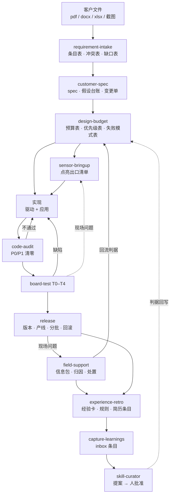

# 工作流闭环（workflow）

技能之间靠**工件**连接，不靠记忆。本文件定义：每个阶段产出什么、谁消费、门禁是什么、不达标退回哪一段。

## 全流程



## 工件落盘位置

模板在技能目录里，**产出写进项目**。两者绝不能混——写进技能目录会导致：下次 `git pull` 冲突、模板被覆盖、单技能安装时路径断裂。

```
<项目根>/
├─ docs/                                  ← 交付物，进仓库
│  ├─ spec.md                             customer-spec
│  ├─ change-requests/CR-<编号>.md         customer-spec
│  ├─ design.md                           design-budget（D1–D6 六张表）
│  ├─ host-protocol.md                    board-test（定稿后的协议）
│  ├─ test-plan.md                        board-test
│  ├─ audit-report.md                     code-audit
│  ├─ release-checklist-v<版本>.md         release（每版一份）
│  ├─ field/<日期>-<一句话>.md              field-support（每问题一份）
│  └─ retro/<日期>.md                      experience-retro
└─ .embedded/                             ← 本机工作区，.gitignore
   ├─ bringup-log.md                      sensor-bringup 证据日志
   ├─ resume.md                          状态快照（新会话靠它续接，覆盖写）
   ├─ validation-log.md                   事件流（追加写，给技能维护用）
   ├─ inbox.md                            学习收件箱
   └─ evidence/
      ├─ waveforms/                       波形截图
      ├─ regs/                            寄存器 dump
      └─ logs/                            原始日志
```

规则：

1. **模板只读**。要填就从技能目录复制到上表位置，不要就地改原件。
2. `docs/` 是交付物：可评审、可给客户、可进版本控制。
3. `.embedded/` 是本机工作区：**不进仓库**，因为证据常含客户信息且体积大。
4. 每份产出开头写一行 `来源: <技能>/<层>`，方便回溯到判据。
5. 波形、dump、原始 log 一律进 `.embedded/evidence/`，不进 `docs/`。

## 门禁表

每段的出口是下一段的入口。**不达标就退回，不靠"先往下走再说"。**

| 阶段 | 技能 | 入口条件 | 出口工件 | 门禁判据 | 不达标退回 |
|---|---|---|---|---|---|
| 收件 | `requirement-intake` | 客户给了文件 | 条目表 + 冲突表 + 缺口表 | 每条有出处；数字反查通过；冲突已列；缺口已标 | 补抽或换格式 |
| 接需求 | `customer-spec` | 条目表（或客户口头） | spec 十段 + 假设台账 | 每条验收标准可被第三人判定；客户已确认 | 重新访谈 |
| 方案 | `design-budget` | spec 已签字 | 预算表 / 优先级表 / 失败模式表 / 接口 / 状态机 | 六表齐全且互相一致；预算有余量 | 重算或多轮取舍 |
| 点亮 | `sensor-bringup` | 板子可用 | 点亮出口清单 + 证据日志 | 7 项出口全过 | 留在本层，不许进实现 |
| 实现 | 见下节说明 | 方案锁定 | 可编译代码 + 主机侧用例 | `board-test` T0 可跑；接口未被业务代码绕过 | 回 `design-budget` D3 |
| 审计 | `code-audit` | 代码可编译 + 三张表 | 审计报告 | 告警清零；P0/P1 全部有结论；三张表已验证 | 退回实现 |
| 测试 | `board-test` | 审计通过 | 测试计划 + 报告 | T0/T1 全绿；T2 自动出报告；T3 对齐 spec 第 1 段 | 退回实现或点亮 |
| 发布 | `release` | 回归通过 | 交付包 + 发布清单 | 版本可追溯；OTA 断电 20 次可恢复（无 OTA 改为烧录回读 100%）；回滚已演练 | 退回测试 |
| 现场 | `field-support` | 客户报障 | 信息包 + 归因 + 处置记录 | 归因到四级之一且带数字；同批抽检 ≥3 台（无批次记录则同型号任取 3 台） | 补数据，不许改代码 |
| 复盘 | `experience-retro` | 项目收尾或卡点解决 | 经验卡 + 规则 + 简历条目 | 至少一条可执行规则；已回写技能 | 当场重填 |
| 沉淀 | `capture-learnings` | 会话收尾 | inbox 条目 | 有对话内证据；≤5 条；不重复 | 不记 |
| 维护 | `skill-curator` | inbox 攒够 5 条 | 带 diff 的提案 | 两次复现或单次重大损失；eval 不降 | 继续观察 |

## 交接契约

这是"闭环"的实际内容——**上游的输出必须是下游能直接用的形式**。

| 工件 | 产出者 | 消费者 | 用在什么环节 |
|---|---|---|---|
| 需求条目表 + 冲突/缺口 | `requirement-intake` | `customer-spec` | 访谈只问冲突项与缺口项 |
| 验收定义（spec 第 1 段） | `customer-spec` | `board-test` T3 | 用例来源 |
| 异常策略（spec 第 8 段） | `customer-spec` | `design-budget` D5 | 失败模式表逐条覆盖 |
| 预算表 | `design-budget` D1 | `code-audit` A0/A1、`release` | 资源判据、发布余量 |
| 优先级表 | `design-budget` D2 | `code-audit` A2 | 唯一性、RM 顺序 |
| 模块接口（`bus_ops`） | `design-budget` D3 | `board-test` T1 | 打桩点 |
| 错误码表 | `design-budget` D4 | `customer-spec` 第 8 段、`field-support` F2、`board-test` T3 | 判定与归因依据 |
| 点亮出口清单 | `sensor-bringup` | `code-audit` A4/A5、`board-test` | 硬件可信前提 |
| 审计报告 P0/P1 | `code-audit` | `release` 清单 | 合入门禁 |
| 测试报告 | `board-test` | `release` 清单 | 发布门禁 |
| 发布清单 + 回滚演练记录 | `release` | `field-support` F3 | 处置可行性 |
| 诊断命令 / 黑匣子事件 | `board-test`/实现 | `field-support` F0/F1 | 现场采集 |
| 现场信息包 + 回流条目 | `field-support` | `experience-retro`、`skill-curator` | 判据修订 |
| 经验卡的"可复用规则" | `experience-retro` | `skill-curator` | 判据来源 |
| inbox 条目 | `capture-learnings` | `skill-curator` T1 | 提案原料 |

## 覆盖度（诚实版）

| 阶段 | 覆盖 | 说明 |
|---|---|---|
| 需求收件（文件解析） | ✅ | 新增 `requirement-intake` |
| 接需求 | ✅ | |
| 方案与预算 | ✅ | |
| 器件点亮 | ✅ | |
| 驱动实现 | 🟡 | 有意保持薄，见下节 |
| 应用实现 | 🟡 | 有意保持薄，见下节 |
| 代码审计 | ✅ | |
| 测试 | ✅ | |
| 发布 / 产线 / OTA | ✅ | 新增 `release` |
| 现场支持 | ✅ | 新增 `field-support` |
| 复盘 | ✅ | |
| 沉淀与维护 | ✅ | |

### 为什么"实现"这一段故意薄

写代码的纪律不该由一份 300 行的规范来管，否则它要么被无视，要么变成教条。实现段被三件事夹住，已经够用：

1. **`design-budget` D3 先定接口**——接口定了，实现才有边界。
2. **`board-test` T0 先写主机侧测试**——先红后绿，这是最强的实现约束。
3. **`code-audit` 设合入门禁**——A0–A7 把常见坑全扫一遍。

所以实现段不设技能，只在门禁上要求：**T0 用例可跑、接口没被业务代码绕过**。如果你发现某类实现错误反复出现（比如状态机漏 default、错误码被吞），那才是加技能的信号——而且应该由 `skill-curator` 用数据提出来，不是拍脑袋加。

## "闭环"的三层含义

判断一套流程是不是闭环，看这三条，缺一条就只是流水线：

1. **工件闭环**：每个技能的输出都是下一个技能的输入，没有"写完就扔"的文档。（看交接契约表）
2. **门禁闭环**：不达标不能进下一阶段，且知道退回哪一段。（看门禁表）
3. **反馈闭环**：缺陷能回流到**正确的**阶段，沉淀能改写判据。
   - 点亮出的问题回到 `sensor-bringup` 对应层
   - 审计 P0 回到实现，不靠测试兜
   - 现场问题先回到"哪段本该拦住"，**不要直接改代码**
   - 经验经 `capture-learnings` → `skill-curator` 回写判据，下一轮更准

第三条是分水岭：checklist 只增不减，这套会因为反馈变准、因为退役变短。

## 怎么用

不用记十一段。只回答一个问题：**你现在卡在哪一段？**

| 你的感觉 | 进哪一段 |
|---|---|
| 客户说不清要什么 / 需求老变 | `customer-spec` |
| 不知道 RAM 够不够 / 任务怎么分 | `design-budget` |
| 某颗器件不工作 | `sensor-bringup` |
| 代码写完了不敢合 | `code-audit` |
| 不知道怎么测 / 一改就怕 | `board-test` |
| 要发版 / 上产线 / 做 OTA | `release` |
| 客户说设备坏了 / 批量异常 | `field-support` |
| 项目结束了但没留下什么 | `experience-retro` |

跳段是允许的（小改动不必过十一段），但要遵守一条：**跳过的段，风险要显式接受**——比如跳过 `design-budget`，就明确"本次不做资源预算，风险是后期可能重构"。
